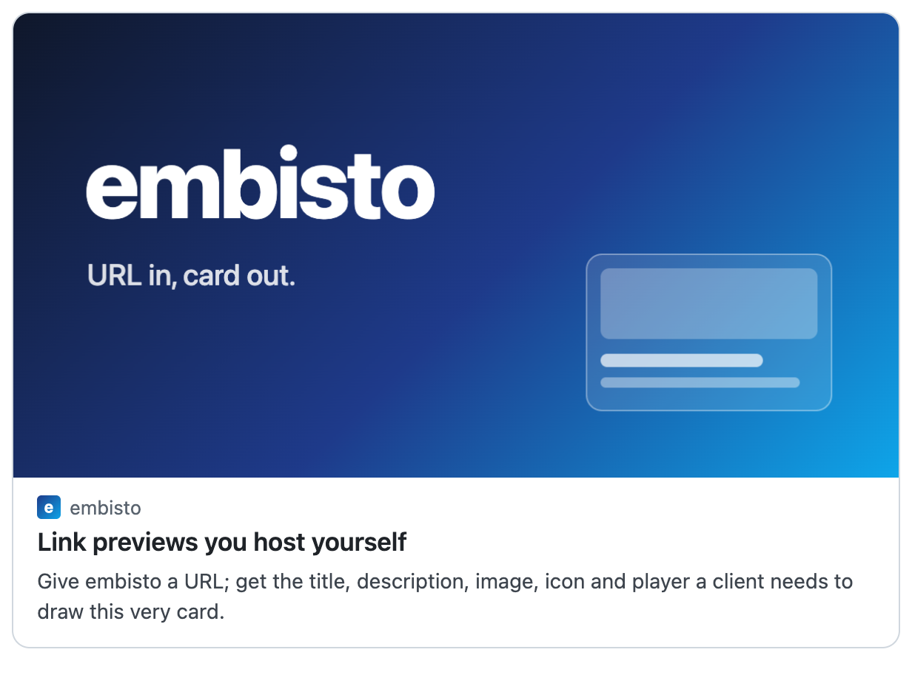

# embisto

**Link previews you host yourself.** Give embisto a URL; get the title, description, image, icon and player a client needs to draw a card.

[](https://github.com/pantafive/embisto/actions/workflows/build-push.yml) [](https://pkg.go.dev/github.com/pantafive/embisto) [](LICENSE)

<picture>
  <source media="(prefers-color-scheme: dark)" srcset="docs/assets/card-dark.png">
  
</picture>

<sub>The card above is embisto's own `format=html`, ready for an iframe or an email.</sub>

## Quickstart

Run the server and ask it about a page:

```sh
docker run --rm -p 8080:8080 ghcr.io/pantafive/embisto:main
curl 'localhost:8080/v1/preview?url=https://go.dev/blog/'
```

```json
{
  "url": "https://go.dev/blog/",
  "canonical_url": "https://go.dev/blog/",
  "type": "link",
  "title": "The Go Blog - The Go Programming Language",
  "icon": {"url": "https://go.dev/images/favicon-gopher-plain.png", "width": 180, "height": 180},
  "image": {"url": "https://go.dev/doc/gopher/runningsquare.jpg", "width": 299, "height": 281},
  "sources": ["opengraph", "twitter", "html"]
}
```

<sub>Shortened: the full card also lists every picture and link the page names. See the [HTTP API](docs/api.md).</sub>

Or use it as a Go library:

```sh
go get github.com/pantafive/embisto
```

```go
core := embisto.New(embisto.Defaults())

result, err := core.Extract(ctx, card.Request{URL: "https://go.dev/blog/"})
if err != nil {
	log.Fatal(card.CodeOf(err)) // invalid_url, blocked_url, fetch_failed, timeout, not_found, …
}
fmt.Println(result.Preview.Title)
```

## Features

- **Reads what pages say:** oEmbed, Open Graph, Twitter Cards, JSON-LD and plain HTML, merged field by field.
- **Knows the hard sites:** YouTube, X, Reddit and TikTok providers, honest cards for login walls, and every site on the [oembed.com](https://oembed.com/providers.json) list.
- **Answers in the format you need:** the JSON card, plain text, a self-contained HTML card, Iframely-compatible `/iframely` and `/oembed`, or your own [template](docs/templates.md).
- **Serves thumbnails:** signed, resized JPEG, PNG and WebP copies of a card's pictures, so clients never load them from other sites ([details](docs/thumbnails.md)).
- **Caches by the origin's rules:** keeps a card as long as its page allows, makes one fetch for many identical requests, and shares the cache between instances through Redis or Valkey.
- **Safe to point at the internet:** refuses private addresses at connect time, and caps sizes, time and memory ([details](docs/hardening.md)).
- **Easy to run:** a single static binary or a multi-arch image, Prometheus metrics, OpenAPI at `/openapi.json` with a reference at `/docs`, and a debug page that shows how a card was made.

## Documentation

- [HTTP API](docs/api.md): the card, routes and error codes
- [Configuration](docs/configuration.md): environment variables and memory
- [Caching](docs/caching.md) and [operations](docs/operations.md): metrics and the debug page
- [Go library](docs/library.md): the pipeline, site providers and layers
- [Templates](docs/templates.md), [thumbnails](docs/thumbnails.md), [Iframely compatibility](docs/iframely-compat.md), [hardening](docs/hardening.md)
- [Contributing](CONTRIBUTING.md) and [security](SECURITY.md)

## License

[MIT](LICENSE) © [Mikhail Solomenik](https://github.com/pantafive)

The binary also holds Go's standard library, the modules embisto imports and the oembed.com provider list. Their notices are in `THIRD_PARTY_NOTICES`, next to the binary in a release archive and in `/usr/share/doc/embisto/` in the image; `go run ./scripts/notices` writes them for a checkout.
